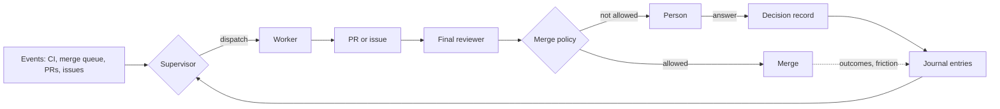

# The graph

supervisor is an autonomous, self-improving graph of coding agents. Its goals are:

1. **Autonomous.** Work goes from an event to a merged PR with no prompt to a person, wherever the merge policy allows it.
2. **Self-improving.** Friction an agent records becomes a rule, a skill change or an issue, so the same mistake costs less next time.

_Coding harnesses are the commodity. Business impact is what we build the harness around._

## What we don't build

- **A coding harness.** Claude Code, Codex, Grok and Antigravity are a commodity, and they improve on their own. We don't build or tune one. We build workflows around them, and switch between them as they change.
- **A dispatcher or runtime.** Everything runs locally. Sessions, panes and workers belong to a terminal multiplexer for agents, today [herdr](https://herdr.dev). The supervisor is designed to drive it rather than replace it (that integration is not built yet), and it is just as replaceable: if a better one appears, we switch.

- **A reviewer.** The final review before a merge belongs to a separate review agent, [code-reviewer](https://github.com/jonathanong/code-reviewer), in its own session.
- **A hosted service or CI job.** The supervisor is a local session, and a merge needs an attended one.
- **New merge policy.** The supervisor encodes the installation's merge rules. It does not widen them.

A change that adds a custom dispatcher, or works around a harness bug instead of reporting it upstream, is out of scope by design.

## What we do build

- **A harness around business impact.** The path from a business need to a shipped change that works: deciding which work matters, getting it done well with whichever coding harness is best that month, and checking whether it moved the outcome.

## Why

- **People focus on business outcomes and customer satisfaction,** not on babysitting agents.
- **Engineers focus on principles.** Their work is the rules that let agents build well-designed systems without supervision. So principled rules, with feedback loops that keep them true, are a key part of this system.
- **Engineers architect principles, not features.** Engineers should not need to design each feature. They design the principles that let agents design features well.
- **A prototype is most of the way to production.** In the ideal case, a product manager prototypes a working feature with an agent, and an engineer ships it to production with minimal changes.
- **Speed never costs quality.** More autonomy must not mean more incidents, reverts or regressions. Autonomy widens one category at a time, and only on evidence.
- **Knowledge outlives models and sessions.** Lessons live in rules, eval cases and static checks, not in one model's habits or one session's memory. A new model, harness or vendor starts with everything learned so far.
- **A lesson learned once helps everywhere.** A mistake found in one repository becomes a principle every repository gets, public ones included, without private details.
- **People are interrupted only for real decisions,** in batches, each with the evidence and a recommended answer. The same question is never asked twice.
- **Work is visible on GitHub.** Anyone can read who is doing what, and why, from the forge, not only the person running the agents.
- **Smaller models do most of the work.** Principles in skills and guardrails such as static checks ([no-mistakes](https://github.com/jonathanong/no-mistakes)) carry the knowledge, so smaller, cheaper models can do the bulk of the work well. The largest models are saved for hard reasoning, review and decisions. Eval cases show which tier a kind of work needs, and each rule that lets a smaller model pass moves more work down a tier.
- **Capacity is spent deliberately.** Usage limits and CI minutes go where they matter most, and none sits idle while ready work waits.
- **Every goal has a number.** The measures in [guardrails.md](guardrails.md#the-numbers) show whether the system is improving, rather than assuming it is.

This page is the overview. Each part of the graph has its own page, linked below.

## Who does what

The supervisor watches, routes, restarts and decides. It does none of the work itself, in the Erlang sense of a supervisor.

| Tier               | Who                                             | Does                                                                   | Merges                                                                                      |
| ------------------ | ----------------------------------------------- | ---------------------------------------------------------------------- | ------------------------------------------------------------------------------------------- |
| Supervisor         | One long-running agent session                  | Waits on events, runs sweeps, routes work, reviews outcomes, escalates | Only what the [merge policy](merge-policy.md) allows, and only PRs no other live agent owns |
| Repo orchestrators | One session per repository or lane, any harness | Own their repository's work and PRs                                    | Their own repository, under the same policy                                                 |
| Workers            | Subagents in isolated worktrees                 | Open every PR: fixes, flake fixes, skill changes                       | Never                                                                                       |
| Final reviewer     | A separate review agent                         | Reviews the current head of a PR before merge                          | Never                                                                                       |

One supervisor covers many scopes: GitHub organizations and user accounts, each with its own list of repositories and its own mode. A scope in `report` mode is triaged and reported on, with no worker PRs and no merges.

## The spine

Every loop shares one path: an event or a journal entry arrives, the supervisor classifies it, a worker produces a PR or an issue, the final reviewer approves the head, and the merge policy decides whether the PR merges or goes to a person.

The dotted edge and the decision record are what make it self-improving. Merges, failures and answers flow back into the journal, and the journal is distilled into rules.

## The loops

| Loop                   | From                                                              | To                                             | Page                                             |
| ---------------------- | ----------------------------------------------------------------- | ---------------------------------------------- | ------------------------------------------------ |
| 1. Journal             | Friction agents record in sessions                                | Issues and rule change requests                | [journal.md](journal.md)                         |
| 2. Skill feedback      | Change requests from loops 1 and 5, and review findings           | Skill and rule changes merged on an eval delta | [skill-feedback.md](skill-feedback.md)           |
| 3. CI and merging      | Merge-queue ejections and CI failures                             | Flake fixes, then merges                       | [ci-and-merging.md](ci-and-merging.md)           |
| 4. Claims and taxonomy | Agents picking up work                                            | Ownership, milestones and labels on GitHub     | [claims-and-taxonomy.md](claims-and-taxonomy.md) |
| 5. Escalations         | Questions the supervisor brings a person                          | Rules, so the question is not asked again      | [escalations.md](escalations.md)                 |
| 6. Backlog             | Ready issues in open milestones                                   | Dispatched work                                | [backlog.md](backlog.md)                         |
| 7. Late reviews        | Review comments after merge, or unresolved at merge               | Follow-up issues                               | [late-reviews.md](late-reviews.md)               |
| 8. Maintenance         | Scheduled prompt files in each repository                         | Draft PRs or verified no-ops, and housekeeping | [maintenance.md](maintenance.md)                 |
| 9. CI performance      | Timings, queue time, cache hits and cost of passing CI            | Measured speed-ups                             | [ci-performance.md](ci-performance.md)           |
| 10. Workarounds        | Pins, overrides and exemptions added for a CVE or an upstream bug | Removed once the fix ships                     | [workarounds.md](workarounds.md)                 |

Loops 1, 5 and 7 feed loop 2: a distilled theme, a repeated answer, or a recurring review finding whose fix is a rule becomes a skill change request. Loops 2, 3, 6, 8, 9 and 10 produce PRs, and all of them pass the same merge gate.

## Other ways work arrives

- [intake.md](intake.md): reports from other agents, comment commands (`/shepherd`, `/plan`, `/fix`), handing a PR to the supervisor, and the triage of open automation PRs.
- [dependency-updates.md](dependency-updates.md): dependency-bot PRs, from patch bumps to major migrations.

## Cross-cutting parts

- [coordination.md](coordination.md): the supervisor owns coordination. It knows who is working on what, so two agents never fix the same flake.
- [merge-policy.md](merge-policy.md): what may merge without a person, written in the Claude Approvals `approvals.yml` format.
- [dispatch.md](dispatch.md): where work runs, and how usage limits across several accounts and harnesses shape it.
- [privacy.md](privacy.md): what may leave a private repository, and how that is enforced before a push.
- [config.md](config.md): the one JSON file per installation, and how a scope overrides its defaults.
- [guardrails.md](guardrails.md): shadow mode, merge records, the stop switch, and what the supervisor may never change about itself.
- [evals-design.md](evals-design.md): how the evals the autonomy depends on are built.
- [use-cases.md](use-cases.md): the real incidents this design answers.

## State and wake-ups

- **Events wake the supervisor.** It waits on GitHub events (ejections, failed default-branch runs, PR closes, Dependabot PRs, commands in comments) through [hook-harness](https://github.com/jonathanong/hook-harness), with one wait over every owner and one cursor.
- **A fallback sweep** runs on a timer, every few hours, in case an event was missed. Nothing polls while the event wait is healthy.
- **The journal lives in [agent-blackboard](https://github.com/jongleberry/agent-blackboard).** Agents write entries with its own tools, against JSON Schemas registered on the server.
- **Local state** (cursors, the flake ledger, merge records) is one file the supervisor owns. It is private and never committed to a public repository.

## Surfaces

| Surface          | Holds                                                                                                                                                         |
| ---------------- | ------------------------------------------------------------------------------------------------------------------------------------------------------------- |
| `supervisor` CLI | The supervisor's own steps: `policy check` and `policy explain`, distill classify and route, claim reconciliation, `prepush`                                  |
| MCP server       | Tools for agents: `pr_create`, `pr_update`, `pr_validate`, `session_facts`, [`policy_check`](merge-policy.md#the-policy_check-mcp-tool), `coordination_check` |
| Skills           | Procedures that are not code: the supervisor loop, the skill-feedback procedure, claims                                                                       |
| JSON Schemas     | Journal entry shapes, registered in agent-blackboard                                                                                                          |
| Config           | One JSON file per installation, kept private. Scopes, provenance fields, who may merge, how to request the final review. See [config.md](config.md)           |

`policy_check`, `pr_create`, `pr_update`, and `pr_validate` are live on `supervisor mcp`; see [merge-policy.md](merge-policy.md#the-policy_check-mcp-tool) and [claims-and-taxonomy.md](claims-and-taxonomy.md#claims).

## Harness agnostic

Skills name capabilities, not tools: a recurring job, a self-paced wake-up, a background command, an isolated worker, a message to another session, an escalation to a person. An adapter per harness maps each capability to that harness's tool.

| Capability              | In Claude Code                                                                                                                               |
| ----------------------- | -------------------------------------------------------------------------------------------------------------------------------------------- |
| Recurring job           | `CronCreate`, or a cloud routine                                                                                                             |
| Self-paced wake-up      | `ScheduleWakeup` under `/loop`                                                                                                               |
| Background command      | Bash with `run_in_background`                                                                                                                |
| Isolated worker         | An agent with `isolation: "worktree"`                                                                                                        |
| Message another session | `SendMessage`, or `herdr agent prompt` from any harness                                                                                      |
| Escalate to a person    | A push notification                                                                                                                          |
| Journal and PR tools    | The MCP tools, under the prefix the host gives them. The prefix differs per harness, so a skill names the tool and the agent searches for it |

A harness with no recurring-job tool can still run single sweeps on request. That is the floor for "harness agnostic".

Any harness can run workers and sweeps. Merging stays with an attended Claude session, as the merge policy's host and model settings require.
