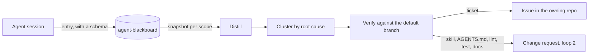

# Loop 1: journal → action items

Agents record friction as they work: a check that failed and then recovered, a sandbox denial, a missing tool, a scope change, the same fix applied twice. The supervisor distills those entries into action items, each routed to where its fix belongs.

[Back to the graph](graph.md)

## Writing entries

- Agents write to [agent-blackboard](https://github.com/jongleberry/agent-blackboard) with its own MCP tools. There is no wrapper.
- Every entry names a JSON Schema registered on the server, and the server validates the entry against it. A new schema can run in shadow mode first, so it can be tested without rejecting other agents' writes.

## Distilling

1. **Per scope.** Distill runs once per scope, over the sessions whose entries name that scope's repositories.
2. **Cluster.** Entries are grouped by root cause across sessions and repositories, not by wording.
3. **Verify.** Each cluster is checked against the current default branch. A problem already fixed is dropped.
4. **Promote.** A theme becomes an action item when it recurs in two or more sessions, or once when its severity is high.
5. **Route by destination.** Each action item carries a destination:

| Destination                                  | Goes to                                                                                    |
| -------------------------------------------- | ------------------------------------------------------------------------------------------ |
| `ticket`                                     | An issue in the repository it concerns                                                     |
| `skill`, `AGENTS.md`, `lint`, `test`, `docs` | A change request in [loop 2](skill-feedback.md), against the repository that owns the rule |

A finding about a private repository stays in that repository. See [privacy.md](privacy.md).

### When the distill cannot run

Partitioning can refuse a session that exceeds its size bound, or snapshot export, verification, or
an un-flushed worktree outbox can block the run. How an oversized session is partitioned belongs to
agent-blackboard, not the supervisor, so the supervisor never splits a session group or weakens the
partition bound. Instead it removes any local snapshot, records the reason as one summary line,
leaves `retroCursor` unadvanced, and keeps the remaining sweep phases running. In an `enforce` scope
(never on `--dry-run`), it also escalates once keyed in `escalations`; in a `report` scope, it
records only the summary line and writes nothing to `escalations`.

### Report mode

In a `report` scope nothing is filed and nothing is archived, so inspecting every partition on every
sweep buys only a summary. The supervisor reports the snapshot's session and entry counts from
`snapshot_export`, then hand-verifies only a bounded sample of at most 5 of the newest matching
sessions per scope, labeled as a sample in the summary (see
[journal-distill.md](../skills/supervisor-sweep/references/journal-distill.md)). It files nothing,
archives nothing, leaves `retroCursor` unadvanced, and still removes the local snapshot.
